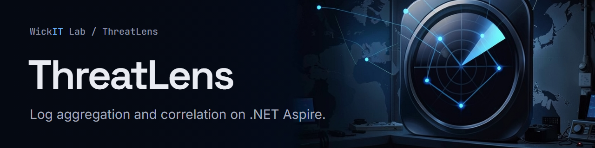

<p align="center">
  
</p>

**Log aggregation and correlation engine on .NET Aspire, with regex rules that tag and escalate events as they arrive.**

ThreatLens ingests log events over an HTTP API, stores them in PostgreSQL, and runs a background correlator that matches each event's message against regex rules, tags the match and raises the event's severity. A read-side API serves the events and 24-hour stats, and a Blazor Server dashboard sits behind a cookie login. It is a portfolio and technical-demo repo, so it is kept stable rather than extended.

Built with .NET 10, ASP.NET Core minimal APIs, EF Core with PostgreSQL, Redis and Blazor. It runs locally under .NET Aspire: one `dotnet run` starts Postgres, Redis, pgAdmin, RedisInsight and the four services, with OpenTelemetry traces, metrics and logs in the Aspire dashboard.

## Contents

- [Tech stack](#tech-stack)
- [Prerequisites](#prerequisites)
- [Getting started](#getting-started)
- [Environment variables](#environment-variables)
- [Features (built)](#features-built)
- [Usage](#usage)
- [Project structure](#project-structure)
- [Security](#security)
- [What's not yet built](#whats-not-yet-built)
- [License](#license)

## Tech stack

| Layer | Technology |
| --- | --- |
| Runtime | .NET 10 (SDK pinned in `global.json`, roll forward to the latest feature band) |
| Orchestration | .NET Aspire AppHost (service discovery, containers, dashboard) |
| APIs | ASP.NET Core minimal APIs (Ingest and Query) |
| Correlator | `BackgroundService` worker |
| Dashboard | Blazor Server (interactive components), cookie authentication |
| Persistence | EF Core 10 with Npgsql, code-first migrations |
| Data stores | PostgreSQL (with pgAdmin) and Redis (with RedisInsight), run as Aspire-managed containers |
| Observability | OpenTelemetry through shared service defaults |
| Tests | xUnit |
| CI | GitHub Actions (restore, build, test, vulnerable-package check) and CodeQL scanning |

## Prerequisites

- [.NET 10 SDK](https://dotnet.microsoft.com/download/dotnet/10.0)
- [Docker Desktop](https://www.docker.com/products/docker-desktop/) (Aspire runs Postgres and Redis as containers)
- Optional: [VS Code](https://code.visualstudio.com/) with the C# Dev Kit extension

## Getting started

1. Clone and build:

   ```bash
   git clone https://github.com/wickitlab/ThreatLens.git
   cd ThreatLens
   dotnet restore
   dotnet build
   ```

2. Run the full stack:

   ```bash
   dotnet run --project src/ThreatLens.AppHost
   ```

   The Aspire dashboard opens on a localhost port printed in the console. From there you can reach each service, inspect traces and watch logs.

3. Copy the one-time secrets from the service logs (Aspire dashboard, Console tab):
   - the **initial ingest API key**, logged by `ingest-api` on first start (`tl_` prefix; it cannot be retrieved later)
   - the **bootstrap dashboard admin** (`admin@threatlens.local`) and its password, logged by `dashboard` on first start unless you set `THREATLENS_ADMIN_PASSWORD`

4. Run the tests:

   ```bash
   dotnet test tests/ThreatLens.Tests/ThreatLens.Tests.csproj
   ```

To iterate on a single service without Aspire, configure your own Postgres and Redis connection strings in that service's `appsettings.Development.json`, then run it directly:

```bash
dotnet run --project src/ThreatLens.Ingest.Api
```

## Environment variables

| Variable | Used by | Purpose |
| --- | --- | --- |
| `THREATLENS_ADMIN_PASSWORD` | Dashboard | Password for the bootstrap admin created on first start. Must be at least 12 characters; if unset or shorter, a random password is generated and logged once. |

## Features (built)

### Ingest and query

- **Ingest API**: `POST /events` and `POST /events/batch` accept log events with source, severity, message, host, optional timestamp and raw payload
- **API-key auth**: ingest and query endpoints require a bearer key; keys are stored as SHA-256 hashes and can be revoked
- **Query API**: `GET /events` with `limit` (clamped to 1-500), `afterId` cursor, `minSeverity` and `source` filters; `GET /events/{id}`; `GET /stats` for the 24-hour severity breakdown plus total and pending counts

### Correlation

- **Background correlator**: polls every 5 seconds for uncorrelated events (batches of 200), matches enabled rules, records the rule name on the event and raises its severity to the rule's level
- **Regex safety**: each match runs with a 1-second timeout; invalid or slow patterns are logged and skipped

### Dashboard and platform

- **Blazor dashboard**: cookie-authenticated Blazor Server app with PBKDF2 password hashing, a login page and a bootstrap admin; it reaches the Query API through a service credential
- **.NET Aspire orchestration**: one `dotnet run` starts Postgres, pgAdmin, Redis, RedisInsight and all four services
- **OpenTelemetry**: unified traces, metrics and logs across services, visible in the Aspire dashboard
- **EF Core and PostgreSQL**: code-first schema with indexes on timestamp and on correlated state plus severity

## Usage

The ingest and query ports are assigned by Aspire; read them from the Aspire dashboard. Both APIs expect the key as `Authorization: Bearer <key>`.

### Send a single event

```bash
curl -X POST http://localhost:{ingest-port}/events \
  -H "Authorization: Bearer $THREATLENS_KEY" \
  -H "Content-Type: application/json" \
  -d '{
    "source": "sshd",
    "severity": 3,
    "message": "Failed password for root from 10.0.0.7",
    "host": "web-01"
  }'
```

### Severity levels

| Value | Name |
| --- | --- |
| 0 | Debug |
| 1 | Info |
| 2 | Warn |
| 3 | Error |
| 4 | Critical |

### Add a correlation rule

Rules are rows in the `CorrelationRules` table (EF Core keeps the PascalCase names, so quote them in SQL), and there is no rule API yet. The worker reloads enabled rules on every 5-second poll.

```sql
insert into "CorrelationRules" ("Name", "Pattern", "ElevateTo", "Enabled")
values ('failed-ssh', 'Failed password.*from', 4, true);
```

Events whose message matches the regex (case-insensitive) are tagged with `MatchedRule = 'failed-ssh'` and raised to Critical. The first matching rule wins, and an event's severity is never lowered.

### Query recent events

```bash
curl -H "Authorization: Bearer $THREATLENS_KEY" \
  "http://localhost:{query-port}/events?limit=50&minSeverity=3"
```

### 24-hour stats

```bash
curl -H "Authorization: Bearer $THREATLENS_KEY" "http://localhost:{query-port}/stats"
```

## Project structure

```text
ThreatLens/
  ThreatLens.sln
  global.json                       Pins the .NET 10 SDK
  src/
    ThreatLens.AppHost/             Aspire orchestrator (Postgres, Redis, services)
    ThreatLens.ServiceDefaults/     Shared OpenTelemetry, health, resilience, API-key filter
    ThreatLens.Domain/              Entities: LogEvent, CorrelationRule, Severity, ApiKey, User
    ThreatLens.Data/                EF Core context, migrations, API-key and password hashing
    ThreatLens.Ingest.Api/          POST /events, /events/batch
    ThreatLens.Correlator.Worker/   Background rule matching
    ThreatLens.Query.Api/           GET /events, /events/{id}, /stats
    ThreatLens.Dashboard/           Blazor Server UI with cookie login
  tests/
    ThreatLens.Tests/               xUnit tests (API keys, password hashing)
  assets/                           README banner, logo, social preview and icons
```

Design notes are in [ARCHITECTURE.md](ARCHITECTURE.md) and [HOW_IT_WORKS.md](HOW_IT_WORKS.md); contribution rules are in [CONTRIBUTING.md](CONTRIBUTING.md).

## Security

ThreatLens is a demo stack, and [SECURITY.md](SECURITY.md) lists its trust boundaries and known limitations. Report vulnerabilities to support@wickitlab.com rather than in a public issue.

- API keys are 32 random bytes, stored only as SHA-256 hashes, compared in fixed time; plaintext keys are shown once in the logs
- Dashboard cookies are `HttpOnly` and `SameSite=Strict`, with an 8-hour sliding expiry
- The dashboard's service key is stored in plaintext in the database, so it suits a single-host dev setup and not a shared production database
- There is no rate limiting, no audit log, and the first-start key and admin password appear in the application log
- Every service runs migrations on startup, so a compromised service account has DDL rights on the database

## What's not yet built

From [ROADMAP.md](ROADMAP.md). The repo is deliberately frozen: no feature work is scheduled beyond keeping CI and Dependabot green.

- A dashboard event feed: the home page is still the Blazor template, and only the login is built
- Redis pub/sub between ingest, correlator and dashboard (Redis is wired in but not used for messaging; the correlator polls every 5 seconds)
- A rule management API and UI (rules are inserted into the database by hand today)
- API key rotation and user management beyond the first-start seed
- Integration tests for the three services (the tests cover API keys and password hashing only)
- A production deployment guide separate from the Aspire dev stack
- Structured payload parsing (`RawPayload` is opaque), alerting and webhook sinks, SSO, multi-tenant isolation and retention policy

## License

This project is dual-licensed:

- [AGPL v3](LICENSE) - free for open-source use. Derivatives and SaaS deployments must release their source under AGPL.
- [Commercial license](COMMERCIAL.md) - for proprietary or closed-source use, or hosted services that do not want to comply with AGPL source-disclosure requirements. Contact support@wickitlab.com for terms.
